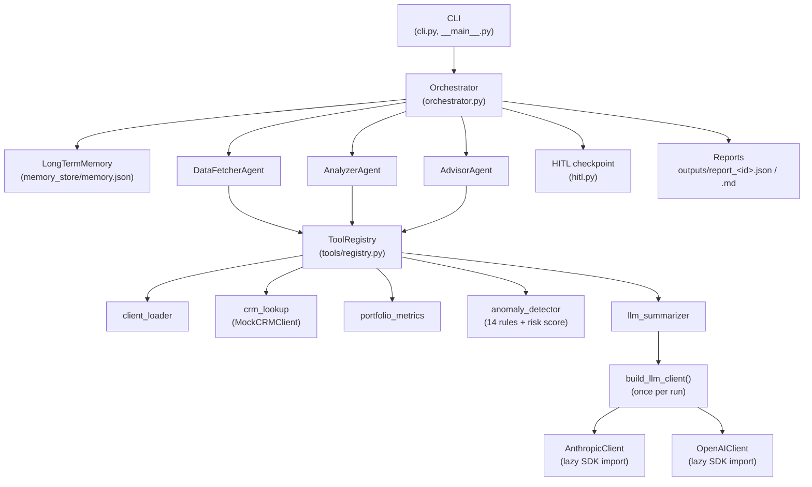

# Wealth Advisor Agents

A lightweight multi-agent Wealth Advisor Assistant. Three small agents
(DataFetcher → Analyzer → Advisor) run a declarative pipeline per client:
ingest portfolio data, detect anomalies with 14 deterministic rules, generate
recommendations, pass a human-in-the-loop checkpoint, and write JSON +
Markdown reports.

**Constraints:** Python 3.11 · base deps only `pydantic>=2` + `pytest` ·
no LangChain/CrewAI · runs fully without an LLM or API key (LLM is optional
and narrative-only).

## 1) Overview

Given `data/clients.json` (clients, accounts, holdings, transactions) and
`data/crm_mock.json` (advisor records), the system produces one report per
client:

- `outputs/report_<client_id>.json` — machine-readable, validated against the
  `Report` pydantic model
- `outputs/report_<client_id>.md` — human-readable summary with tables

Every tool call returns `ToolResult(ok, data, error, meta)` and never raises
to its caller. All runs emit structured JSON-lines logs (`ts`, `level`,
`run_id`, `agent`, `event`, `message`, `extra`) to the console and
`outputs/run.log`. Cross-run state lives in `memory_store/memory.json`
(anomaly history per client for new/resolved/worsened diffs).

## 2) Architecture



- **Agents** (`src/wealth_assistant/agents/`) never call implementations
  directly; they call tools through the injected `ToolRegistry`.
- **Tools** (`src/wealth_assistant/tools/`) are single-purpose; `Tool.run()`
  wraps `_execute()` so failures become `ToolResult(ok=False, ...)`.
- **LLM layer** (`src/wealth_assistant/llm/`) is provider-neutral
  (`LLMClient` ABC). The client is built once at startup; the summarizer
  tool falls back to a deterministic template when no client is available.
- **Memory** is a plain JSON file with atomic writes (temp file + rename).

## 3) Agent interactions and flow

Per client, the orchestrator executes a declarative step list:

1. **ingest** (`DataFetcherAgent`, critical) — `client_loader` validates the
   client record (per-client errors don't abort the batch); `crm_lookup`
   fetches the advisor record. Client not found → step fails → client gets a
   `failed` report, batch continues. CRM missing/error → `degraded`, pipeline
   continues with a warning.
2. **analyze** (`AnalyzerAgent`, critical) — `portfolio_metrics` (total value,
   allocation, drift vs target, concentration) then `anomaly_detector`
   (14 rules, sorted high→low, plus risk score capped at 100). Memory is
   loaded *before* this step so `prior_balances` feeds the `balance_drop`
   rule. No transactions → warning, transaction rules skipped.
3. **recommend** (`AdvisorAgent`, non-critical) — deterministic rule→action
   mapping (e.g. drift→rebalance, concentration→diversify, expired KYC→urgent
   refresh), then `llm_summarizer` via the registry. Advisor failure degrades
   instead of failing the client.
4. **HITL checkpoint** (`hitl.py`) — required when any anomaly is `high` or
   `risk_score >= 70` (`HITL_RISK_THRESHOLD`). Interactive terminal prompt:
   `[a]pprove` / `[o]verride` (change priority or delete a recommendation,
   note mandatory; edits are merged back into the report) / `[r]eject`.
   `--auto-approve` or non-TTY stdin → `decision: "auto"` with a warning.
   Calm reports → `decision: "not_required"`.
5. **report + memory** — writes the JSON/Markdown reports. Rejected reports
   are written but **not** saved to memory. Otherwise the summary (score,
   anomaly ids/types/severities, recommendation actions, total balance) is
   saved and `changes_since_last_review` (`new`/`resolved`/`worsened` by
   anomaly id) is computed on the next run.

Each step is wrapped in try/except and appended to `trace` with
`duration_ms`. Exit code is 0 unless *every* client failed.

## 4) Key decisions and trade-offs

- **Deterministic analysis + LLM narrative, not fully LLM-driven.** All
  numbers, anomalies, scores and recommendations are computed by audited
  Python rules; the LLM only writes the executive summary. *Gave up:* the
  fluency of LLM-generated recommendations; *gained:* reproducibility and a
  system that works with zero API spend.
- **JSON file memory, not a database.** `memory_store/memory.json` is enough
  for per-client last-run summaries and needs no server. *Gave up:*
  concurrent writers, querying history; *gained:* zero dependencies and
  inspectable state.
- **CLI HITL, not a web UI.** Approve/override/reject happens in the
  terminal. *Gave up:* rich review UX and remote approvers; *gained:*
  no frontend, no auth, scriptable via `--auto-approve`.
- **No agent framework.** Agents are ~60-line classes with an injected
  registry. *Gave up:* built-in retries/tool-use loops; *gained:* every
  behavior is explicit and testable without mocks of framework internals.
- **Sequential per-client processing, not async.** One client at a time keeps
  logging, memory writes and HITL prompts simple and deterministic.
  *Gave up:* throughput on large books; *gained:* debuggability (the whole
  run is a linear log).

## 5) Assumptions

- Input is a JSON file shaped like `data/clients.json` (see
  `src/wealth_assistant/models.py` for the exact contracts). Amounts are
  numbers; date-only transaction timestamps are treated as midnight for the
  24h velocity rule.
- All rule thresholds, severities, retry policy (3 attempts, 0.5/1/2s
  backoff) and `HITL_RISK_THRESHOLD = 70` are centralized in
  `src/wealth_assistant/config.py`.
- The CRM is a mock over `data/crm_mock.json`; `CRM_FAILURE_MODE`
  (`timeout`/`server_error`/`not_found`) exists only to test degradation.
- Single-process CLI usage: memory is loaded once at startup; concurrent
  runs could clobber `memory_store/memory.json`.
- Sample data dates fall between 2026-07-20 and 2026-10-15; currency is USD.

## 6) How to run

```cmd
:: Windows cmd.exe
pip install -r requirements.txt
set PYTHONPATH=src && python -m pytest tests/ -q
set PYTHONPATH=src && python -m wealth_assistant run --all --auto-approve --no-llm
```

```powershell
# PowerShell equivalent
$env:PYTHONPATH="src"; python -m pytest tests/ -q
```

```bash
# Linux / macOS
pip install -r requirements.txt
PYTHONPATH=src python -m pytest tests/ -q
PYTHONPATH=src python -m wealth_assistant run --all --auto-approve --no-llm
```

**LLM setup** (optional — everything works without it):

```bash
pip install -r requirements-llm.txt   # anthropic, openai, python-dotenv
cp .env.example .env                  # then set LLM_PROVIDER, LLM_MODEL,
                                      # and ANTHROPIC_API_KEY or OPENAI_API_KEY
PYTHONPATH=src python -m wealth_assistant run --all --auto-approve
```

Useful flags: `--client C002` (single client), `--data path/to.json`,
`--llm-provider anthropic|openai`, `--crm-failure timeout|server_error|not_found`.

**Failure-injection examples:**

```bash
# CRM keeps timing out -> client is degraded, pipeline completes
PYTHONPATH=src python -m wealth_assistant run --client C001 --auto-approve --no-llm --crm-failure timeout
# or via environment variable
CRM_FAILURE_MODE=server_error PYTHONPATH=src python -m wealth_assistant run --client C001 --auto-approve --no-llm
```

**Tests:** `python -m pytest tests/ -q` → 103 passed. No network access
and no API keys are needed; LLM tests use an offline fake client.

## 7) LLM behavior matrix

| Situation | `build_llm_client()` | `narrative.summary_source` |
|---|---|---|
| Valid key + SDK + network | client built (ping OK) | `llm:<provider>:<model>` |
| Invalid key | ping fails → warning → `None` | `template` |
| No key in env | warning → `None` | `template` |
| No network | ping fails → warning → `None` | `template` |
| SDK not installed | warning → `None` | `template` |
| `--no-llm` flag | skipped entirely | `template` |
| LLM returns malformed JSON | retried once with a nudge, then `template` | `template` |

The client is constructed lazily (SDK imported inside `__init__`) and cached
per process. Anomalies, risk score and recommendations are identical with or
without the LLM (covered by an end-to-end test).

## 8) Privacy and security notes

- The LLM prompt contains only `client_id` plus aggregate findings (risk
  score, anomaly types/counts, total value). **Client names, account numbers
  and raw transactions are never sent** (enforced by a test).
- API keys live only in the environment or `.env` (gitignored); they are
  never logged or written to reports.
- Structured logs and reports carry `client_id`, not names or PII.
- `memory_store/memory.json` and `outputs/` are local files; add your own
  access controls if they hold real client data.

## 9) Sample input/output

Input (`data/clients.json`, trimmed):

```json
{
  "clients": [
    {
      "client_id": "C002",
      "name": "Budi Santoso",
      "risk_profile": "moderate",
      "accounts": [{ "account_id": "A201", "type": "checking", "balance": 8000 }],
      "transactions": [
        { "id": "C002-T17", "account_id": "A201", "date": "2026-08-10",
          "amount": -1200, "merchant": "Grocery Store", "category": "groceries" }
      ]
    }
  ]
}
```

Representative run outputs (from `python -m wealth_assistant run --all --auto-approve --no-llm`):

- `outputs/sample_output.json` — full `Report` JSON for C002
  (status `success`, risk 100, 6 anomalies, 1 recommendation, HITL `auto`)
- `outputs/sample_report.md` — the rendered Markdown report for C002
- `outputs/sample.log` — the structured JSON-lines log of that run

## 10) Future improvements

- Replace `MockCRMClient` with a real CRM connector (same `Tool` interface).
- Parallelize per-client processing (memory writes need locking first).
- Optional DB-backed memory for multi-run history queries.
- Richer HITL (e.g. web review queue) while keeping the CLI path.
- More LLM providers behind the existing `LLMClient` ABC.
